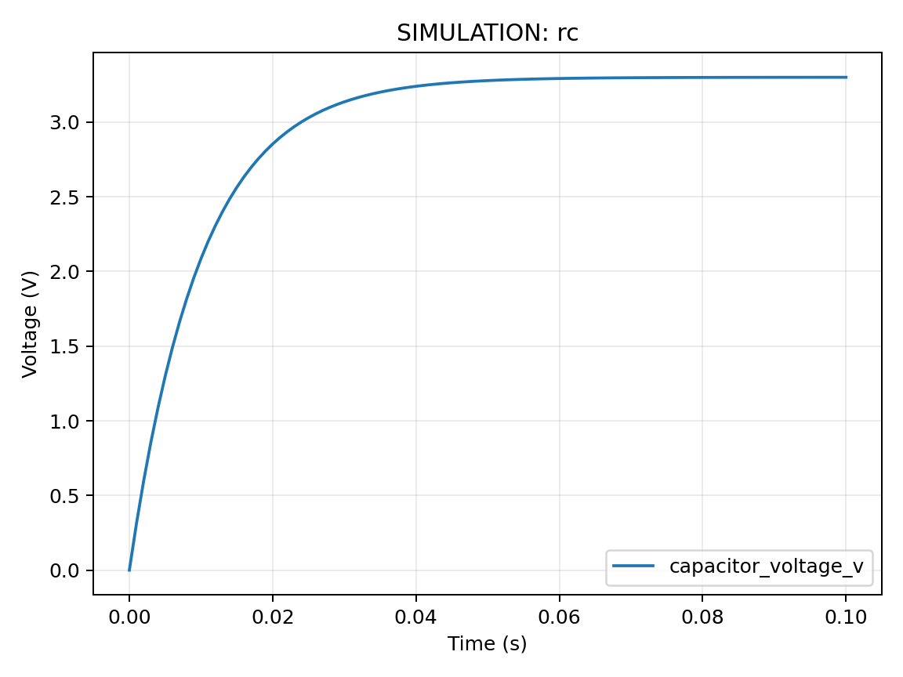
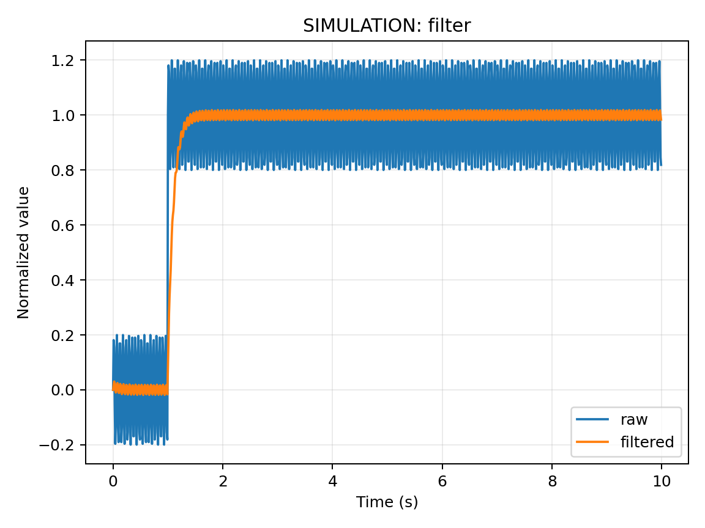

# ESP32 系统学习手册

面向有少量 C/C++ 和电路基础、希望系统复习并独立完成项目的学习者。以经典 ESP32-D0WD、4 MB Flash、CH340 Type-C 开发板及四针 I²C OLED 为主线。

**学习路线：基础复习 → VS Code + PlatformIO + Arduino → ESP-IDF + FreeRTOS → 完整项目。** 数学推导、物理模型、代码、接线和验收放在同一学习链路中。

## 从哪里开始

1. 阅读01–05章，确认板卡、配件和电脑环境。OLED型号未确认时先扫描地址，再确认控制器及分辨率。
2. 用18章完成串口与芯片信息，用24–25章点亮现有OLED，再完成58章网络时钟。你目前已有的配件足够进行这条入门路线。
3. 按06–17章复习基础，再顺序学习外设和网络。每章练习有参考思路，重点理解代码改变后为什么出现相应现象。
4. 用40–53章补齐系统工程，最后完成59–62章综合项目。需要额外硬件的章节会注明。

**电脑运行与开发板运行：** Python上位机及仿真脚本直接运行在Windows/Linux；Arduino和ESP-IDF固件由电脑交叉编译，再在ESP32上运行。软件回环、仿真和编译成功均不能替代真机实验。

**验证进展：** Ubuntu已完成28个Arduino/综合工程、11个原生IDF工程及两种OTA配置编译；Windows原生IDF已在真实路径重建，旧临时盘符不再需要。2026-11-01已上传GitHub，Actions的Windows、Ubuntu和IDF三个任务及下载报告校验均通过，结果见[GitHub验证](validation/GITHUB_ACTIONS.md)。另见[本地验证报告](validation/REPORT.md)、[缓存与失败记录](validation/CONTINUATION-2026-10-31.md)。硬件实测仍按用户安排暂缓。

## 完整目录

### 认识设备与准备环境

- [01 学习路线与阶段目标](docs/01-guide/01-学习路线与阶段目标.md)
- [02 ESP32芯片模组开发板与型号区别](docs/01-guide/02-ESP32芯片模组开发板与型号区别.md)
- [03 硬件清单接线规范与实验工具](docs/01-guide/03-硬件清单接线规范与实验工具.md)
- [04 Windows开发环境完整配置](docs/01-guide/04-Windows开发环境完整配置.md)
- [05 Linux开发环境完整配置](docs/01-guide/05-Linux开发环境完整配置.md)

### 数学与物理基础

- [06 电压电流电阻功率与基本电路定律](docs/02-math-and-physics/06-电压电流电阻功率与基本电路定律.md)
- [07 电容电感RC电路与瞬态响应](docs/02-math-and-physics/07-电容电感RC电路与瞬态响应.md)
- [08 单位量纲进制位运算与数值表示](docs/02-math-and-physics/08-单位量纲进制位运算与数值表示.md)
- [09 嵌入式需要的函数微积分与离散时间](docs/02-math-and-physics/09-嵌入式需要的函数微积分与离散时间.md)
- [10 信号采样量化噪声与误差](docs/02-math-and-physics/10-信号采样量化噪声与误差.md)
- [11 原理图数据手册与电路测量](docs/02-math-and-physics/11-原理图数据手册与电路测量.md)

### C/C++详细复习

- [12 变量类型运算符与流程控制](docs/03-c-and-cpp/12-变量类型运算符与流程控制.md)
- [13 函数数组字符串与边界检查](docs/03-c-and-cpp/13-函数数组字符串与边界检查.md)
- [14 指针内存生命周期与常见错误](docs/03-c-and-cpp/14-指针内存生命周期与常见错误.md)
- [15 结构体枚举头文件与模块化](docs/03-c-and-cpp/15-结构体枚举头文件与模块化.md)
- [16 嵌入式C++类资源管理与回调](docs/03-c-and-cpp/16-嵌入式C++类资源管理与回调.md)
- [17 预处理编译链接与构建系统](docs/03-c-and-cpp/17-预处理编译链接与构建系统.md)

### Arduino与基础外设

- [18 第一个工程串口输出与芯片信息](docs/04-peripherals/18-第一个工程串口输出与芯片信息.md)
- [19 GPIO输入输出LED与按键去抖](docs/04-peripherals/19-GPIO输入输出LED与按键去抖.md)
- [20 非阻塞编程定时器与中断](docs/04-peripherals/20-非阻塞编程定时器与中断.md)
- [21 ADC模拟采样量程与校准](docs/04-peripherals/21-ADC模拟采样量程与校准.md)
- [22 PWM呼吸灯与DAC模拟输出](docs/04-peripherals/22-PWM呼吸灯与DAC模拟输出.md)
- [23 UART串口原理协议与通信实验](docs/04-peripherals/23-UART串口原理协议与通信实验.md)
- [24 I2C原理地址扫描与设备通信](docs/04-peripherals/24-I2C原理地址扫描与设备通信.md)
- [25 OLED文字图形字体与菜单](docs/04-peripherals/25-OLED文字图形字体与菜单.md)
- [26 SPI通信与SD卡数据记录](docs/04-peripherals/26-SPI通信与SD卡数据记录.md)
- [27 RMT脉冲计数与电容触摸](docs/04-peripherals/27-RMT脉冲计数与电容触摸.md)

### 传感器与控制

- [28 温湿度传感器与可靠数据采集](docs/05-sensing-and-control/28-温湿度传感器与可靠数据采集.md)
- [29 标定滑动平均与数字滤波](docs/05-sensing-and-control/29-标定滑动平均与数字滤波.md)
- [30 三极管MOSFET舵机与电机驱动](docs/05-sensing-and-control/30-三极管MOSFET舵机与电机驱动.md)
- [31 反馈控制与离散PID入门](docs/05-sensing-and-control/31-反馈控制与离散PID入门.md)

### 无线通信与物联网

- [32 WiFi连接热点事件与断线重连](docs/06-networking/32-WiFi连接热点事件与断线重连.md)
- [33 IP端口Socket与TCP和UDP](docs/06-networking/33-IP端口Socket与TCP和UDP.md)
- [34 HTTP和HTTPS服务及WebSocket](docs/06-networking/34-HTTP和HTTPS服务及WebSocket.md)
- [35 MQTT消息通信与本地服务器](docs/06-networking/35-MQTT消息通信与本地服务器.md)
- [36 BLE广播连接与GATT服务](docs/06-networking/36-BLE广播连接与GATT服务.md)
- [37 经典蓝牙与蓝牙串口](docs/06-networking/37-经典蓝牙与蓝牙串口.md)
- [38 ESP-NOW双板通信与可靠传输](docs/06-networking/38-ESP-NOW双板通信与可靠传输.md)
- [39 配网时间同步与设备发现](docs/06-networking/39-配网时间同步与设备发现.md)

### ESP-IDF与实时系统

- [40 Arduino到ESP-IDF的迁移](docs/07-esp-idf-and-rtos/40-Arduino到ESP-IDF的迁移.md)
- [41 CMake组件Kconfig与工程配置](docs/07-esp-idf-and-rtos/41-CMake组件Kconfig与工程配置.md)
- [42 ESP-IDF外设驱动与事件机制](docs/07-esp-idf-and-rtos/42-ESP-IDF外设驱动与事件机制.md)
- [43 FreeRTOS任务优先级与调度](docs/07-esp-idf-and-rtos/43-FreeRTOS任务优先级与调度.md)
- [44 队列信号量互斥锁与任务通知](docs/07-esp-idf-and-rtos/44-队列信号量互斥锁与任务通知.md)
- [45 双核并发共享资源与中断边界](docs/07-esp-idf-and-rtos/45-双核并发共享资源与中断边界.md)
- [46 状态机分层设计与工程架构](docs/07-esp-idf-and-rtos/46-状态机分层设计与工程架构.md)

### 存储功耗与工程质量

- [47 启动流程分区NVS与文件系统](docs/08-reliability/47-启动流程分区NVS与文件系统.md)
- [48 低功耗休眠唤醒与续航计算](docs/08-reliability/48-低功耗休眠唤醒与续航计算.md)
- [49 OTA升级版本管理与失败回滚](docs/08-reliability/49-OTA升级版本管理与失败回滚.md)
- [50 内存栈堆看门狗与资源泄漏](docs/08-reliability/50-内存栈堆看门狗与资源泄漏.md)
- [51 日志崩溃分析与JTAG调试](docs/08-reliability/51-日志崩溃分析与JTAG调试.md)
- [52 测试性能测量与持续集成](docs/08-reliability/52-测试性能测量与持续集成.md)
- [53 凭据TLS固件安全与设备身份](docs/08-reliability/53-凭据TLS固件安全与设备身份.md)

### Python上位机

- [54 Python串口通信与命令行工具](docs/09-python-tools/54-Python串口通信与命令行工具.md)
- [55 数据记录CSV与实时绘图](docs/09-python-tools/55-数据记录CSV与实时绘图.md)
- [56 HTTP和MQTT设备控制面板](docs/09-python-tools/56-HTTP和MQTT设备控制面板.md)
- [57 自动化测试数据回放与故障注入](docs/09-python-tools/57-自动化测试数据回放与故障注入.md)

### 完整综合项目

- [58 OLED网络时钟与设备状态终端](docs/10-projects/58-OLED网络时钟与设备状态终端.md)
- [59 温湿度监测显示记录与联网](docs/10-projects/59-温湿度监测显示记录与联网.md)
- [60 低压智能控制器与远程操作](docs/10-projects/60-低压智能控制器与远程操作.md)
- [61 电池供电的低功耗采集节点](docs/10-projects/61-电池供电的低功耗采集节点.md)
- [62 ESP-NOW无线采集网络与网关](docs/10-projects/62-ESP-NOW无线采集网络与网关.md)

### 进阶应用与拓展

- [63 I2S数字音频与声音采集](docs/11-advanced/63-I2S数字音频与声音采集.md)
- [64 彩屏摄像头与边缘推理入门](docs/11-advanced/64-彩屏摄像头与边缘推理入门.md)
- [65 RS485和Modbus及TWAI与CAN](docs/11-advanced/65-RS485和Modbus及TWAI与CAN.md)
- [66 从面包板到PCB与产品化基础](docs/11-advanced/66-从面包板到PCB与产品化基础.md)
- [67 其他ESP32型号与无线生态迁移](docs/11-advanced/67-其他ESP32型号与无线生态迁移.md)
- [68 MicroPython与开发路线比较](docs/11-advanced/68-MicroPython与开发路线比较.md)

### 查阅与复习

- [69 按症状检索的故障排查手册](docs/12-reference/69-按症状检索的故障排查手册.md)
- [70 GPIO接口命令与公式速查](docs/12-reference/70-GPIO接口命令与公式速查.md)
- [71 中英文术语与习题参考答案](docs/12-reference/71-中英文术语与习题参考答案.md)
- [72 官方资料代码来源与许可证](docs/12-reference/72-官方资料代码来源与许可证.md)

## 示例工程与工具

每个固件工程可以独立打开。先阅读工程README和章节，再修改本地配置并构建；示例端口、IP和密码占位符必须按实际环境替换。工程引脚规划不等于任意开发板排针位置。

| 类型 | 工程入口 |
|---|---|
| Arduino / PlatformIO | [actuator](examples/arduino/actuator/), [adc](examples/arduino/adc/), [ble](examples/arduino/ble/), [bluetooth_serial](examples/arduino/bluetooth_serial/), [espnow](examples/arduino/espnow/), [filter](examples/arduino/filter/), [gpio_button](examples/arduino/gpio_button/), [http](examples/arduino/http/), [i2c_scan](examples/arduino/i2c_scan/), [language_basics](examples/arduino/language_basics/), [mqtt](examples/arduino/mqtt/), [oled](examples/arduino/oled/), [pid](examples/arduino/pid/), [pulse_touch](examples/arduino/pulse_touch/), [pwm_dac](examples/arduino/pwm_dac/), [sd_logger](examples/arduino/sd_logger/), [serial_info](examples/arduino/serial_info/), [sht30](examples/arduino/sht30/), [tcp_udp](examples/arduino/tcp_udp/), [time_provision](examples/arduino/time_provision/), [timing_interrupt](examples/arduino/timing_interrupt/), [uart](examples/arduino/uart/), [wifi](examples/arduino/wifi/) |
| 原生 ESP-IDF | [audio_capture](examples/esp-idf/audio_capture/), [deep_sleep](examples/esp-idf/deep_sleep/), [diagnostics](examples/esp-idf/diagnostics/), [gpio](examples/esp-idf/gpio/), [i2c_sensor](examples/esp-idf/i2c_sensor/), [lcd_st7789](examples/esp-idf/lcd_st7789/), [nvs_storage](examples/esp-idf/nvs_storage/), [ota](examples/esp-idf/ota/), [rs485_echo](examples/esp-idf/rs485_echo/), [tasks_queue](examples/esp-idf/tasks_queue/), [twai_loopback](examples/esp-idf/twai_loopback/) |
| 综合项目 | [battery_node](examples/projects/battery_node/), [environment_station](examples/projects/environment_station/), [espnow_gateway](examples/projects/espnow_gateway/), [low_voltage_controller](examples/projects/low_voltage_controller/), [oled_clock](examples/projects/oled_clock/) |
| Python | [安装与命令](examples/python/README.md) · [串口](examples/python/serial_tool.py) · [绘图](examples/python/plot_csv.py) · [网络](examples/python/network_tool.py) · [控制面板](examples/python/dashboard.py) · [数学实验](examples/python/math_lab.py) |

## 原理图与数学实验

章节使用接线表和Mermaid图说明电路、数据流和状态。以下曲线由随附Python程序生成，**全部为模型仿真，不是真实传感器测量**。

| RC阶跃响应 | 一阶低通滤波 |
|---|---|
|  |  |

[混叠演示](assets/alias.png) · [离散PID模型](assets/pid.png) · [生成参数与说明](assets/README.md)

## 版本、验证和使用边界

主线固定 Espressif32 8.0.0 / Arduino-ESP32 3.3.12；独立 ESP-IDF 6.1。Python直接依赖固定在requirements.txt。Windows 11和Ubuntu 24.04为文档目标；实际验证机器与结果分别记录，远程Ubuntu实际为22.04.5。

- [验证报告](validation/REPORT.md)：实际构建、Python运行、未验证项和限制。
- [来源与许可索引](docs/12-reference/72-官方资料代码来源与许可证.md)：官方资料、第三方库和版本追溯。
- [结构检查](scripts/check_handbook.py)：72章数量、本地链接、代码围栏和Python语法。
- [批量构建](scripts/build_examples.py)：只构建，不上传固件。
- [硬件验收表](validation/HARDWARE_CHECKLIST.md)：需要开发板和外设完成的实验记录。

每个关键推导说明假设、单位、数值例题和误差来源。外接负载只使用安全低压实验，GPIO采用3.3V逻辑。复杂摄像头、USB或无线协议的能力按目标芯片区分，不默认你的经典ESP32具备整个家族的所有功能。
