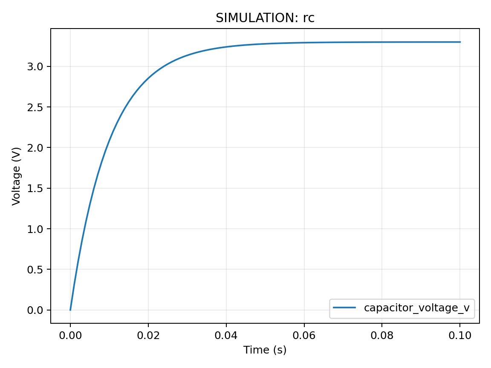

# 07 电容、电感、RC 电路与瞬态响应

前置：[06 基本电路定律](06-电压电流电阻功率与基本电路定律.md)。配套：本章 Python 计算脚本；在第 24 章 I²C 实验中验证。返回：[总目录](../../README.md)。

## 为什么数字信号不是垂直的边沿

GPIO 输入、导线和器件都具有电容。电容的关系是 $q=CV$，对时间求导得到 $i=C\,\mathrm{d}V/\mathrm{d}t$。如果要让电压瞬间跳变，理想模型需要无限电流；真实电路无法做到，因此边沿具有有限上升时间。电容单位为 F，常见 100 nF 等于 $10^{-7}$ F。

电感满足 $v=L\,\mathrm{d}i/\mathrm{d}t$，它阻碍电流突变。电机线圈断电时若没有合适的电流回路，电感会产生高电压；这正是执行器驱动需要考虑续流路径的物理原因。磁能为 $E_L=Li^2/2$，电容能量为 $E_C=CV^2/2$，都不是“断电立即消失”。

## 从电路方程推导 RC 充电

考虑理想电源 $V_s$ 在 $t=0$ 经电阻 R 接到初始电压为 0 的电容 C，忽略漏电和测量负载。由 KVL 和电容关系：

$$V_s=Ri+V_C=RC\frac{\mathrm{d}V_C}{\mathrm{d}t}+V_C.$$

移项、分离变量并积分：

$$\frac{\mathrm{d}V_C}{V_s-V_C}=\frac{\mathrm{d}t}{RC},\qquad
-\ln(V_s-V_C)=\frac{t}{RC}+K.$$

代入 $V_C(0)=0$ 求积分常数，得到：

$$V_C(t)=V_s(1-e^{-t/\tau}),\quad \tau=RC.$$

单位检查：$\Omega\cdot\mathrm{F}=\mathrm{s}$。在一倍时间常数时达到最终电压约 63.2%；三倍约 95.0%；五倍约 99.3%。达到阈值 $\alpha V_s$ 的时间为 $t=-RC\ln(1-\alpha)$。放电到地时 $V_C(t)=V_0e^{-t/RC}$，不能直接套用充电式的起始条件。

例：R=10 kΩ、C=100 nF，则 $\tau=1$ ms；达到 70% 约需 1.204 ms。这个时间不是所有输入都通用的逻辑翻转时间，输入阈值和施密特触发特性需查芯片数据手册。

```python
import math
r_ohm, c_f, supply_v = 10_000.0, 100e-9, 3.3
tau_s = r_ohm * c_f
for multiple in (0, 1, 2, 3, 5):
    t_s = multiple * tau_s
    voltage_v = supply_v * (1.0 - math.exp(-t_s / tau_s))
    print(f"t={t_s*1000:5.2f} ms, V={voltage_v:.3f} V")
```

可将 R 改为 47 kΩ 观察所有时间等比例伸长；改变电源电压只改变幅度，不改变理想模型的时间常数。真实电容容差、漏电、源阻抗和探头电容会造成偏差。

## 用配套脚本重现曲线

完整计算入口为 [math_lab.py](../../examples/python/math_lab.py)。在仓库根目录使用 Windows 的 `.\.venv\Scripts\python.exe` 或 Linux 的 `./.venv/bin/python` 执行脚本，例如 Windows 命令如下，Linux 只替换解释器路径：

```powershell
.\.venv\Scripts\python.exe examples/python/math_lab.py rc --output data/rc.csv --plot data/rc.png
```

不加 `--plot` 时仅生成 CSV，绘图需要按 Python 示例依赖安装 matplotlib。配套图使用 R=10 kΩ、C=1 µF，时间常数是 **10 ms**，是上文 100 nF 例子的十倍；两条曲线的归一化形状相同，时间尺度不同。



图中数据由模型产生，不是用示波器测得。修改 R 或 C 后重新生成到 `data/`，与原图比较，避免把修改后的参数与原图混用。

## I²C 上拉与上升时间

I²C 常采用开漏输出：设备主动拉低，释放后由上拉电阻给总线电容充电。若按 30% 到 70% 定义上升时间，上述模型给出：

$$t_r=t_{70}-t_{30}=RC\ln\frac{0.7}{0.3}\approx0.8473RC.$$

假设总线电容 100 pF、R=4.7 kΩ，则 $t_r\approx398$ ns。判断是否合格必须对照所用 I²C 速度模式的时序要求；电容未知时这个结果只是估算。更小 R 降低上升时间，却增加低电平吸收电流，需同时满足设备的拉低能力。示波器探头也增加电容，测量系统本身会影响结果。

## 去抖与电源去耦的区别

按键机械接点可能在几毫秒内多次接通断开。RC 可抑制快变化，但还需保证输入阈值、边沿和按键电流合适；软件去抖通常要求状态稳定一段时间再确认。电源去耦电容用于在局部提供瞬时电流，不能代替容量不足的电源。模型 $\Delta V\approx I\Delta t/C$ 可以估算电压变化，但实际还受 ESR、ESL 与稳压器响应影响。

练习：电容不变，R 翻倍，70% 阈值到达时间怎样变？答案：翻倍。并联第二个 I²C 模块为何可能同时改善和恶化边沿？答案：其上拉减小等效 R，而模块和导线增加 C，需综合判断。电机断电尖峰为何不能靠让 GPIO 输出低解决？答案：线圈能量需要电流路径，GPIO 不应承担驱动与钳位电流。

来源：[NXP I²C 总线规范 UM10204](https://cache.nxp.com/docs/en/user-guide/UM10204.pdf)、[MIT 电路课程](https://ocw.mit.edu/courses/6-002-circuits-and-electronics-spring-2007/)。下一步：[08 单位与数值](08-单位量纲进制位运算与数值表示.md)。
