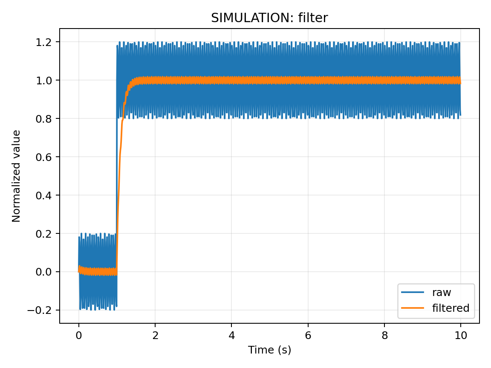

# 09 嵌入式需要的函数、微积分与离散时间

前置：[06 电路](06-电压电流电阻功率与基本电路定律.md)、[08 单位](08-单位量纲进制位运算与数值表示.md)。配套：本章跨平台 Python 例子。返回：[总目录](../../README.md)。

## 函数描述输入与输出

温度传感器把真实温度映射为数字，显示程序又把数字映射为像素，这些映射都可抽象为函数。线性标定 $y=ax+b$ 中，a 是斜率，b 是偏置。假设传感器在两个参考点分别给出 $x_1,x_2$，真实值为 $y_1,y_2$：

$$a=\frac{y_2-y_1}{x_2-x_1},\qquad b=y_1-ax_1.$$

例如原始读数 100、900 对应 0、80 ℃，则 a=0.1 ℃/count，b=-10 ℃，原始 500 对应 40 ℃。这是两点线性模型，只适用于确实近似线性的范围，不能证明中间没有非线性，也不能在量程外随意外推。

## 导数是变化速率

平均速度是 $\Delta x/\Delta t$，当时间段趋近于零就得到导数 $v=\mathrm{d}x/\mathrm{d}t$。单位为“输出单位/秒”。电容电流 $i=C\,\mathrm{d}v/\mathrm{d}t$ 用电压变化速率解释为什么快边沿需要较大瞬时电流。程序无法连续观察无限多个时刻，通常使用差分近似：

$$\dot x[k]\approx\frac{x[k]-x[k-1]}{T_s}.$$

采样周期 $T_s$ 必须用秒代入，且值要与真实采样节奏一致。如果任务偶尔延迟，应使用实际时间间隔，或者由定时采样确保周期。差分会放大相邻样本的噪声，因此控制器微分项常需要滤波。

## 积分是累积

积分把许多小时间段的贡献加起来。功率积分得到能量：$E=\int P(t)\,\mathrm{d}t$；电流积分得到电荷。矩形近似为：

$$E[k]=E[k-1]+P[k]T_s.$$

若 P 用 W、T 用 s，能量是 J；除以 3600 才变成 Wh。若电流用 mA、时间用小时，累积得到 mAh。错误单位会让续航估算出现几个数量级的偏差。

梯形法用相邻两个样本的均值估计区间：$E[k]=E[k-1]+(P[k]+P[k-1])T_s/2$。在较平滑信号上通常比简单矩形更准确，但仍无法恢复没有采到的尖峰；采样硬件与测量带宽决定数据是否可信。

## 一阶系统变成可执行代码

低通系统的连续模型为 $\tau\dot y+y=x$。假设每个采样区间输入保持不变，可以得到指数形式的离散更新：

$$y[k]=y[k-1]+\alpha(x[k]-y[k-1]),\quad\alpha=1-e^{-T_s/\tau}.$$

取 $T_s=0.1$ s、$\tau=0.5$ s，$\alpha\approx0.1813$。每次输出向新输入靠近约 18.13%，形成平滑但有延迟的响应。下面代码模拟输入从 0 跳到 1，数据是数学仿真，不是传感器实测：

```python
import math
dt_s = 0.1
tau_s = 0.5
alpha = 1.0 - math.exp(-dt_s / tau_s)
y = 0.0
for k in range(21):
    x = 1.0
    print(f"{k * dt_s:.1f},{y:.6f}")
    y += alpha * (x - y)
```

若改用前向欧拉近似，则系数变为 $T_s/\tau$，这两种离散化不能混称同一个精确公式。欧拉法的稳定性与采样间隔有关，不能随意把 T 设得远大于时间常数。指数更新在本假设下保持 0<α<1，但实际控制闭环还有延迟、饱和和模型误差。

## 观察输入与滤波输出

[math_lab.py](../../examples/python/math_lab.py) 的 `filter` 模式生成叠加干扰的阶跃输入及滤波输出。它采用 T=0.01 s、τ=0.1 s，与上文的小例子参数不同，使用相同的指数更新公式。在项目虚拟环境执行 `python examples/python/math_lab.py filter --output data/filter.csv --plot data/filter.png`；Windows/Linux 分别使用其虚拟环境中的 Python 路径。



观察阶跃出现后输出需要时间追上目标；滤波会抑制快速波动，也会延迟真实变化。此图的原始输入同样由程序生成，不能用它证明真实传感器具有某个噪声水平。

## 对数与指数的工程意义

指数描述 RC 充放电和某些系统响应；对数是其反函数。达到比例 α 的时间用 $t=-\tau\ln(1-\alpha)$ 计算。分贝是比值表示：功率比用 $10\log_{10}(P_2/P_1)$；在相同阻抗下才可把电压比写成 $20\log_{10}(V_2/V_1)$。不要把不同条件下的电压变化直接当功率变化。

练习：功率 0.2 W 持续 30 s，能量多少？答案：6 J，即约 0.001667 Wh。采样周期翻倍而仍使用原 α，滤波的实际时间响应会怎样？答案：每秒更新次数减半，等效响应更慢。为什么温度差分剧烈抖动？答案：测量噪声除以较小的时间间隔被放大，需改善采样和滤波。

参考：[MIT 微积分课程](https://ocw.mit.edu/courses/18-01sc-single-variable-calculus-fall-2010/)。下一步：[10 采样与误差](10-信号采样量化噪声与误差.md)。
