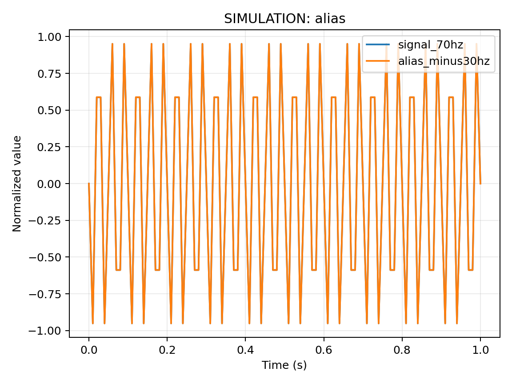

# 10 信号、采样、量化、噪声与误差

前置：[09 连续和离散时间](09-嵌入式需要的函数微积分与离散时间.md)。配套：本章 Python 仿真；真实 ADC 示例见第 21 章。返回：[总目录](../../README.md)。

## 三个步骤不要混淆

模拟信号在时间与幅值上连续。采样把时间变成离散时刻 $t_k=kT_s$；量化把幅值映射到有限个码；编码再把码用二进制表示。采样频率是 $f_s=1/T_s$，分辨率为 N 位表示有 $2^N$ 个码，但不保证有 N 位有效精度。

假定理想单极性均匀 ADC 输入范围为 0 到 $V_{FS}$，量化间隔定义为 $q=V_{FS}/2^N$。12 位、假设满量程 3.3 V 时 q≈0.806 mV。以量化区间中心作估计，非饱和时理想量化误差约在 ±q/2。`raw * V_FS / (2^N-1)` 是把两个端点相连的另一种换算约定，不能拿来替代真实 ADC 的传输曲线校准。

经典 ESP32 的 ADC 衰减、参考偏差、非线性及输入量程要根据实际驱动和芯片规范处理。衰减设置不等于引脚可承受任意更高电压；ADC 供电、逻辑耐压与有效测量范围是不同限制。

## 为什么会混叠

正弦输入 $x(t)=\sin(2\pi f t)$ 的采样为 $x[k]=\sin(2\pi f k/f_s)$。由于正弦具有周期性，把频率增加整数倍 $f_s$ 后会得到同一组离散样本。因此，仅凭样本可能无法判断原始高频信号。

对带限到 B Hz 的理想信号，理想重建要求 $f_s>2B$，同时需要满足采样和重建模型。真实系统在 ADC 之前使用模拟抗混叠滤波，并为滤波过渡带留余量。不能在已经混叠后仅靠数字平均恢复原始频率。

下面展示 900 Hz 信号以 1000 Hz 采样，得到与反向相位 100 Hz 正弦相同的样本：

```python
import math
fs_hz = 1000.0
for k in range(10):
    high = math.sin(2 * math.pi * 900 * k / fs_hz)
    alias = -math.sin(2 * math.pi * 100 * k / fs_hz)
    print(k, round(high, 6), round(alias, 6), abs(high - alias) < 1e-10)
```

这个例子说明信息丢失，不说明真实信号必须是纯正弦。即使只关心缓慢温度，电源干扰、开关信号和传感器内部带宽仍可能影响采样。

## 用配套数据验证混叠

[math_lab.py](../../examples/python/math_lab.py) 的 `alias` 模式使用另一个便于观察的例子：70 Hz 输入以 100 Hz 采样，样本与负 30 Hz 正弦重合。在仓库根目录用项目虚拟环境的 Python 执行 `python examples/python/math_lab.py alias --output data/alias.csv --plot data/alias.png`。Windows 和 Linux 使用相同参数，解释器路径按第 04/05 章选择。



图中连线只是连接离散样本以便阅读，不是恢复了原来连续时间波形。可检查 [原始 CSV](../../assets/alias.csv) 的两列数据，二者仅有浮点舍入量级差异。此图演示数学非唯一性，没有把计算数据当成 ADC 测量结果。

## 噪声、偏差、精密度和准确度

测量可写为 $x_i=x_{true}+b+n_i$，其中 b 为偏差，$n_i$ 为随机变化。样本均值 $\bar x=(1/M)\sum x_i$；样本方差常用 $s^2=\sum(x_i-\bar x)^2/(M-1)$ 估计。重复测量很接近表示精密度较好，但如果全部偏离真实值，准确度仍差。

在噪声独立、同分布、零均值等假设下，平均值的标准差大约按 $1/\sqrt M$ 降低。平均 16 次可使该部分标准差约降到 1/4，却不能消除固定偏差，也不能保证对相关噪声同样有效。数字滤波在降低波动的同时引入延迟，应根据物理变化速度选择窗口。

## 误差传播与测量安排

若 $y=ax+b$，a、b 视为准确时，输入标准不确定度 $\sigma_x$ 传播为 $\sigma_y=|a|\sigma_x$。对于独立小误差，乘除结果的相对不确定度可以近似平方和开根号；如果误差相关或模型非线性，应重新分析，不能机械套式。

例：分压比和 ADC 校准都不确定，最终电压误差不是只看 ADC 一个位的大小。记录原始码、校准电压、采样时间、衰减和接线，可以把量化、系统偏差与采样不稳定分别检查。测量点的共地、接触电阻、源阻抗和电源噪声往往比多打印几位小数更关键。

练习：显示 6 位小数是否意味着微伏精度？答案：显示位数不会增加测量信息。采样 100 Hz 能否准确观察 80 Hz 正弦？答案：不满足带限重建条件，会混叠到较低频率。16 次平均仍有 50 mV 固定偏差，应该继续加平均次数吗？答案：先做校准、检查模型和接线，而不是期望均值消除偏差。

参考：[ESP-IDF ADC 校准](https://docs.espressif.com/projects/esp-idf/en/stable/esp32/api-reference/peripherals/adc_calibration.html)、[MIT 信号与系统](https://ocw.mit.edu/courses/6-003-signals-and-systems-fall-2011/)。下一步：[11 电路测量](11-原理图数据手册与电路测量.md)。
