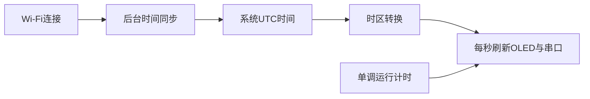

# 58 OLED网络时钟与设备状态终端

[返回总目录](../../README.md)

## 项目目标与器材

前置：第18、24、25、32、39章。只需你已有的ESP32、数据线、OLED与杜邦线。完整工程：[oled_clock](../../examples/projects/oled_clock/)。第一阶段让OLED显示运行时间，第二阶段连接Wi-Fi，第三阶段SNTP同步日历时间，最后加入断网显示。屏幕为空时仍能从串口诊断，不能让显示失败阻止网络运行。

| OLED标识 | ESP32连接 | 说明 |
|---|---|---|
| GND | GND | 共同参考电位 |
| VCC | 3V3 | 先核对模块支持3.3V，勿按排针位置猜测 |
| SCL | GPIO22 | I²C时钟 |
| SDA | GPIO21 | I²C数据 |

先断电接线，用第24章扫描器确认地址，再修改OLED_ADDRESS。0x3C是默认值，不是保证值；扫描器也不能判定SSD1306还是SH1106。默认SSD1306 128×64；SH1106设置OLED_CONTROLLER=1106，SSD1306 128×32设置OLED_HEIGHT=32。128×64单色帧缓冲为128×64/8=1024字节。

## 配置与启动

从工程目录执行Windows：
```powershell
Copy-Item include/config.example.h include/config.local.h
pio run
pio device list
$serialPort = Read-Host '输入枚举出的实际串口'
pio run -t upload --upload-port $serialPort
pio device monitor --port $serialPort --baud 115200
```
Linux：
```bash
cp include/config.example.h include/config.local.h
pio run
pio device list
read -r -p '输入枚举出的实际串口: ' serial_port
pio run -t upload --upload-port "$serial_port"
pio device monitor --port "$serial_port" --baud 115200
```
复制后编辑SSID和密码，端口按实际替换。大陆时区使用POSIX规则CST-8，注意它的符号约定与通常UTC+8写法相反。NTP_SERVER可换为你可访问的可信时间服务器。

## 数据流与代码


startDisplay先探测ACK，缺失时跳过画面但保留串口。startWifi开始连接，pollWifi每15秒重试；loop不在等待网络的无限循环里卡住。configTime发起后台同步，time读取系统时钟；未得到合理时间前明确显示Waiting for SNTP。刷新使用无符号时间差，能正确跨越millis常见回绕，前提是检查间隔远短于回绕周期。

## 时间精度推导与验收

若晶振频率误差为20ppm，离线一天理论误差约86400×20×10⁻⁶=1.728秒。这只是频率误差预算，温度、同步网络延迟和系统校时还会影响读数。millis用于间隔，UTC用于日历，两者不能混用。

验收：首次无Wi-Fi也能显示等待；连接后显示日期；关闭AP时显示离线且本地时钟继续走；恢复后自动联网。OLED无响应先查电源和地址；整体偏移或花屏查控制器与分辨率。练习：添加12/24小时切换；答案要点是只改变strftime格式，不改变底层UTC。来源：[Arduino时间示例](https://github.com/espressif/arduino-esp32/tree/3.3.12/libraries/ESP32/examples/Time)。下一步：第59章。

> 验证状态以[验证报告](../../validation/REPORT.md)为准。命令中的端口与IP仅是示例，请按实际环境替换。
